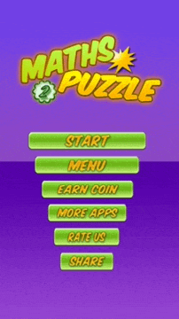

# Math Puzzle
It is a math puzzle android game made with [**Godot Game Engine**](https://godotengine.org/)
(Godot is a **MIT licensed** open source software for 2d and 3d game development).
This game is a better version of my previous game "Math Riddle".

##  Preview

         
                                                       
     
                                                                                                          
                                                        
                                                      
                                                        

## Core Idea
This is a small brain storming game for android devices. It consists many mind challenging math puzzle which should be solved in a given time.

###    Feature
- Every Level consist different math puzzle to challenge your mind. 

- Answer of puzzle with full explaination is given.

## Technology and tools used

- All the graphics are made with photoshop(such as Images and Buttons). 
- All the animation is made with [**Godot Game Engine**](https://godotengine.org/). 
- The language used in the above app is [**Gdscript**](https://docs.godotengine.org/en/stable/getting_started/scripting/gdscript/gdscript_basics.html) 
which is a python build language.
- Sound is taken from different websites and all the sounds are royalty free sound.

#### Related Link
- Watch demo video on youtube by clicking [**here**](https://youtu.be/Ef2wDbdsXj8)
